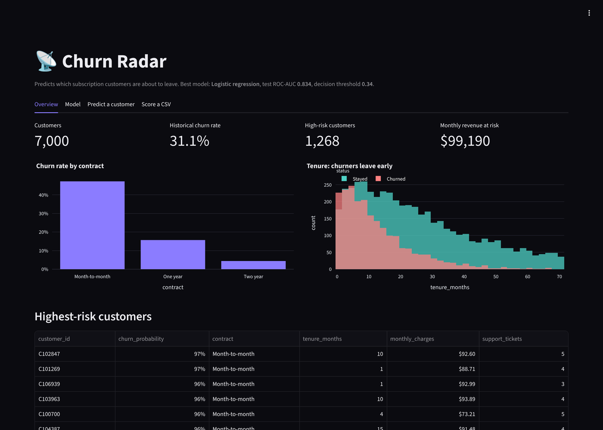
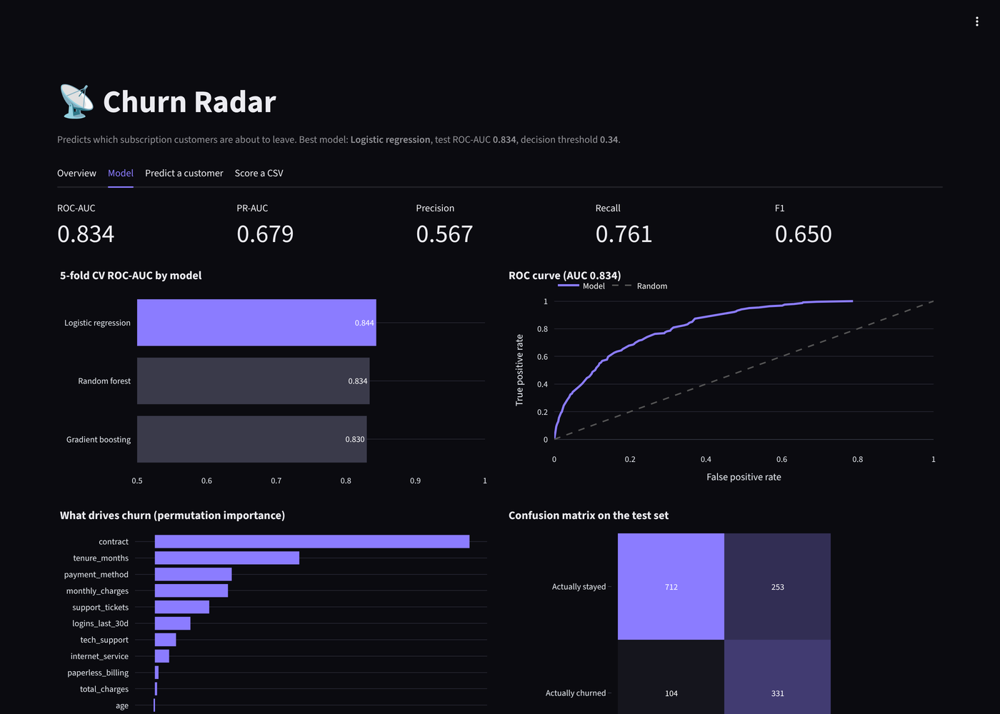
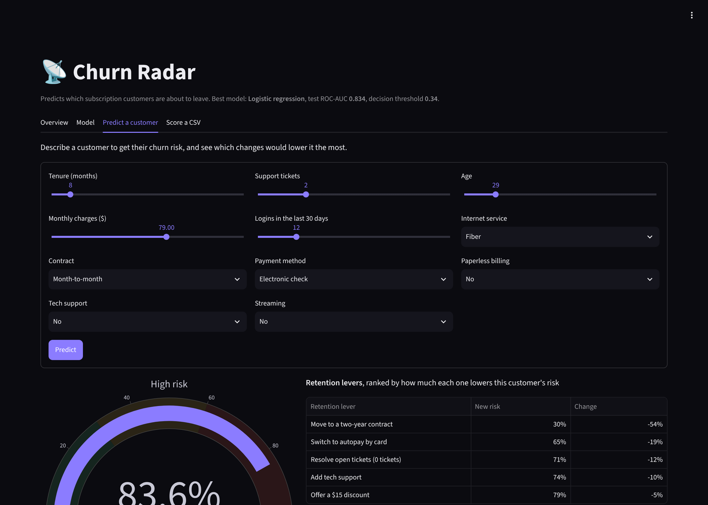

# Churn Radar

**An end-to-end machine learning project that predicts which subscription customers are about to cancel, explains why, and suggests what would keep them.** Built with scikit-learn and an interactive Streamlit dashboard, packaged with Docker and tested in CI.



## What it does

- **Overview**: churn rate, the number of high-risk customers, and the **monthly revenue at risk**, plus the customers to call first
- **Model**: compares three models with 5-fold cross-validation and shows ROC curve, confusion matrix, precision, recall, F1 and the features that drive churn
- **Predict a customer**: enter a customer's details, get their churn probability, and see a ranked list of **retention levers** (for example, how much moving them to a two-year contract would cut their risk)
- **Score a CSV**: upload a customer list and download it ranked by risk

| Model insights | What-if retention levers |
| --- | --- |
|  |  |

## The ML pipeline

1. **Data**: `churn_radar/data.py` generates 7,000 realistic subscription customers (contract, tenure, charges, support tickets, logins, payment method and more). Churn depends on these the way it does in real telecom and SaaS data, with noise so it is not trivially separable. Generating the data keeps the repo self-contained, with no download or private dataset.
2. **Preprocessing**: a scikit-learn `ColumnTransformer` scales numeric features and one-hot encodes categorical ones, inside a single `Pipeline`, so the exact same steps run at training and prediction time.
3. **Model selection**: logistic regression, random forest and histogram gradient boosting are compared with stratified 5-fold CV on ROC-AUC. The best one is refit and evaluated on a held-out 20% test set.
4. **Threshold tuning**: instead of a fixed 0.5 cut-off, the decision threshold is chosen to maximise F1, which handles the class imbalance without distorting the probabilities. Calibrated probabilities matter here because they feed the revenue-at-risk number.
5. **Explainability**: permutation importance on the test set shows which features the model actually relies on.

Typical results:

```
$ python -m churn_radar.train
Churn rate: 31.1% over 7000 customers
  Logistic regression  CV ROC-AUC 0.844
  Random forest        CV ROC-AUC 0.834
  Gradient boosting    CV ROC-AUC 0.830
Best: Logistic regression, threshold 0.34
Test: roc_auc 0.834, pr_auc 0.679, precision 0.567, recall 0.761, f1 0.650
Top drivers: contract, tenure_months, payment_method, monthly_charges
```

The simplest model wins here, which is a useful lesson: always benchmark a linear baseline before reaching for ensembles.

## Run it

```bash
# With Docker (the model is trained during the build)
docker build -t churn-radar .
docker run -p 8501:8501 churn-radar

# Or locally
python -m venv .venv && source .venv/bin/activate
pip install -r requirements-dev.txt
python -m churn_radar.train     # optional: the app trains on first launch if no model exists
streamlit run app.py
```

Open http://localhost:8501.

**Free live demo**: this repo deploys as-is on [Streamlit Community Cloud](https://streamlit.io/cloud). Choose the repo, set the main file to `app.py`, and click Deploy.

## Tests

```bash
pytest
```

The suite checks the data generator, that the model clears a minimum ROC-AUC, that retention levers lower risk, that saved models load back identically, and that the whole dashboard renders without errors using Streamlit's `AppTest`. GitHub Actions also runs Ruff, builds the Docker image and smoke-tests it.

## Project layout

```
churn_radar/
  data.py      Synthetic customer data with realistic churn drivers
  model.py     Pipeline, model comparison, threshold tuning, importance, scoring
  train.py     CLI: generate data, train, save models/model.joblib and metrics.json
app.py         Streamlit dashboard
tests/         pytest suite, including a headless dashboard test
```

## Tech stack

Python 3.13 · scikit-learn · pandas · NumPy · Streamlit · Plotly · joblib · Docker · GitHub Actions · pytest · Ruff

## License

MIT
